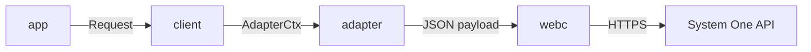
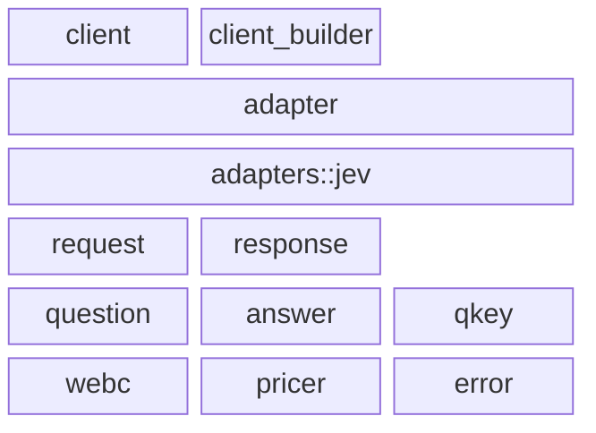
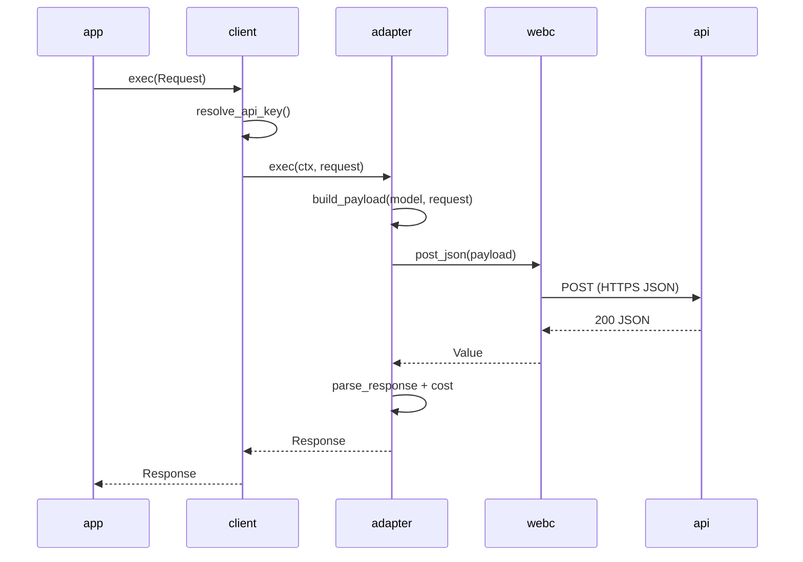

# System One Rust Client (sysone) Architecture

## Intent

Define the architecture and design of the `sysone` crate, a typed async Rust client for the TypeSafe AI System One API (`jev`). The crate turns a natural-language `state` plus a set of typed `questions` into a typed `Response` of `answers`, with minimal ceremony.

Scope of this spec:

- The public request and response data model (`Request`, `Question`, `Answer`, `QKey`, `Response`).
- The client configuration surface (`Client`, `ClientBuilder`, `AdapterKind`).
- The provider adapter abstraction and its static dispatch.
- The HTTP transport boundary and client-side pricing.

Out of scope: the remote System One service, authentication backends, persistence, retry policy, and UI.

The crate exposes a single fluid flow: build a `Request`, hand it to `Client::exec`, and read typed answers back.

- Input: `Request { state, questions }`, plus an API key from the builder or the `TYPESAFE_API_KEY` environment variable.
- Output: `Response { model, answers, input_tokens, output_tokens, cost }`.

The public surface, flattened through `lib.rs` reexports:

```rust
pub struct Client;              // builder, from_endpoint, exec
pub struct ClientBuilder;       // with_endpoint, with_model, with_api_key, with_header, build
pub enum AdapterKind { Jev }    // holds per-provider defaults
pub struct Request;             // state + questions, fluid builder
pub enum Question { Noul, Choice, Score }
pub struct NoulQuestion;
pub struct ChoiceQuestion;
pub struct ScoreQuestion;
pub enum Answer { Noul, Choice, Score }
pub struct NoulAnswer;
pub struct ChoiceAnswer;
pub struct ScoreAnswer;
pub struct QKey;                // Idx(usize) | Name(String)
pub struct Response;            // model, answers, tokens, cost
pub mod pricer;                 // PRICE_PER_MILLION_TOKENS, cost, price_per_million_tokens
```

## Code Design

The crate is organized in four conceptual rings: the public typed model, the client entry, the provider adapter abstraction, and the transport and support utilities. Each ring depends only on rings closer to the data types.

### System Overview

**Goal:** show the major components and how a call moves from the caller program to the remote API.



- **app**: caller program that builds a `Request` and awaits `Client::exec`.
- **client**: resolves the API key and assembles a borrowed `AdapterCtx`; owns endpoint, model, adapter kind, and extra headers.
- **adapter**: static dispatch to the provider implementation; owns payload build, response parse, and cost filling.
- **webc**: thin `reqwest` wrapper; POSTs JSON and maps non-2xx responses to `Error::ResponseError`.
- **api**: remote TypeSafe System One endpoint (`https://api.typesafe.ai/v1/systemone` by default).

### Public Data Model

The typed model maps one-to-one onto the wire shape, using internal tags for the question and answer kinds.

- `Request`: holds `state: serde_json::Value` and `questions: Vec<(QKey, Question)>`. Serialization writes `questions` as a JSON object keyed by each `QKey::wire()`.
- `Question`: internally tagged enum (`type` = `noul` | `choice` | `score`). Each variant wraps a dedicated struct (`NoulQuestion`, `ChoiceQuestion`, `ScoreQuestion`) that carries `instructions` and its variant fields such as `criteria`.
- `Answer`: internally tagged enum (`type` = `noul` | `choice` | `score`) with dedicated structs (`NoulAnswer`, `ChoiceAnswer`, `ScoreAnswer`).
- `QKey`: `Idx(usize)` wire-encodes as `q<i>`, and `Name(String)` wire-encodes as the name itself. Serde round-trips through the wire form.
- `Response`: holds `model`, `answers: Vec<(QKey, Answer)>`, `input_tokens`, `output_tokens`, and a client-computed `cost`.

Representative wire payload:

```json
{
  "model": "jev-latest",
  "state": "...",
  "questions": {
    "intent": { "type": "noul", "instructions": "What does this code do?" },
    "q0": { "type": "choice", "instructions": "Classify", "criteria": { "ok": "Working code" } }
  }
}
```

Constructors and fluid setters keep callers off raw JSON: `Question::noul/choice/score`, `Request::from_state`, `append_question`, `extend_questions`, and `with_questions`. A `From<serde_json::Value>` fallback on `Question` degrades to `Noul` when the value is not a typed question.

### Provider Adapters

Providers sit behind one trait, dispatched by `AdapterKind` through a `match`, without trait objects.

```rust
pub(crate) trait Adapter: Send + Sync {
    fn exec(&self, ctx: AdapterCtx<'_>, request: &Request) -> impl Future<Output = Result<Response>> + Send;
    fn cost(&self, model: &str, input_tokens: u64, output_tokens: u64) -> Option<f64>;
}
```

- `AdapterKind`: single source of per-provider defaults (name, endpoint, model, API key env var) and parsing from a string.
- `AdapterCtx`: a borrowed, `Copy` execution context holding `webc`, `endpoint`, `model`, `api_key`, and `extra_headers`, so no configuration is cloned per call.
- `adapter::exec` / `adapter_dispatch`: a single `match` mapping `AdapterKind` to the concrete adapter.
- `adapters/jev`: the current provider. `JevAdapter` builds the payload, calls the transport, parses the response, and fills cost. `payload.rs` isolates `build_payload` and `parse_response` so wire shaping stays in one place.

### Dependency Layers

**Goal:** show the module layers and the direction of allowed dependencies.



- **client**: public entry; resolves the API key, builds `AdapterCtx`, and delegates to dispatch. Uses `adapter`, `client_builder`, `request`, `response`, `webc`, `error`.
- **client_builder**: collects configuration and constructs a `Client`. Uses `adapter::AdapterKind`, `client`, `webc`, `error`.
- **adapter**: the `Adapter` trait, `AdapterCtx`, `AdapterKind`, and the static `exec` dispatch. Uses `request`, `response`, `webc`, `error`, and `adapters::jev`.
- **adapters::jev**: the `jev` implementation, `build_payload`, and `parse_response`. Uses `adapter` support helpers, `request`, `response`, `answer`, `qkey`, `error`.
- **request**: the `Request` model and fluid builder. Uses `question`, `qkey`.
- **response**: the `Response` model and answer lookup. Uses `answer`, `qkey`.
- **question**: the `Question` enum and typed question structs. Foundation data types.
- **answer**: the `Answer` enum and typed answer structs. Foundation data types.
- **qkey**: the `QKey` type with wire encoding and serde. Foundation.
- **webc**: internal `reqwest` wrapper. Uses `error`.
- **pricer**: client-side token pricing constants and functions. Foundation.
- **error**: the `Error` enum and `Result` alias. Foundation.
- A part may depend only on layers below it, never sideways or up.
- Exception: `client` and `client_builder` reference each other (same layer).
- Exception: `adapter` and `adapters::jev` reference each other, since dispatch calls the implementation while the implementation uses the trait, context, and support helpers.

### Request Lifecycle

**Goal:** show the order of operations for one `exec` call.



- **app**: initiates one call per `Request`.
- **client**: resolves auth before any network call, then hands a borrowed context to the adapter.
- **adapter**: builds the payload, calls the transport, then parses and prices the result.
- **webc**: issues a single POST and maps non-2xx to `Error::ResponseError`.
- **api**: returns JSON that the client parses tolerantly.
- A missing API key produces `Error::AuthNotPresent` before any network call.

### Transport and Pricing

- `webc` wraps `reqwest::Client`, adds `Content-Type: application/json` and bearer auth, applies extra headers, and parses the body into `serde_json::Value`.
- `pricer` holds a fixed constant `PRICE_PER_MILLION_TOKENS` (`0.042` USD) applied to models whose name starts with `jev`. The adapter computes `cost` from input tokens only, returning `None` for unknown models.
- `parse_response` is tolerant: a missing `model` defaults to empty, a missing or non-object `answers` yields no answers, and token usage falls back from `usage.*` to top-level fields, then to `0`.

## Design Considerations

- Internal-tag enums keep one wire `type` field per direction, giving exhaustive matching on both questions and answers while staying stable on the wire.
- `QKey` hides the index-versus-name difference so callers can pass `usize`, `&str`, or `String` interchangeably, while the wire format remains predictable (`q<i>` versus the raw name).
- Static dispatch via `AdapterKind` plus a `match` avoids trait-object boxing and keeps `impl Future` in the trait without `async-trait`. It also makes provider coverage compile-time exhaustive.
- A borrowed, `Copy` `AdapterCtx` avoids cloning per-request configuration and keeps the adapter signature small.
- The `adapters/<name>` folder plus per-provider defaults in `AdapterKind` make a new provider a small addition: one module and one match arm.
- Tolerant response parsing protects callers from minor server changes, enforcing typing only where correctness matters (the answers themselves).
- The fluid builder consumes `self`, so chaining needs no shared mutable state and reads top to bottom.
- Client-side pricing is computed locally from a pinned rate, keeping cost reporting deterministic and independent of server responses.
- The crate stays a single crate today. The folder-per-adapter layout leaves room to split providers into their own crates later without changing the public API.
